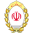
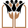
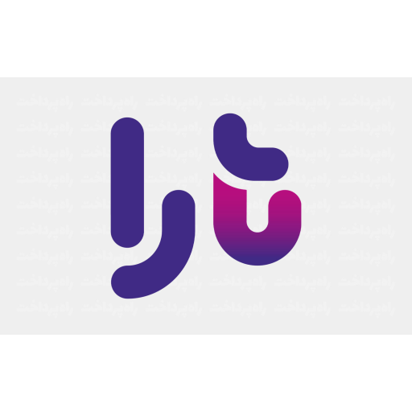
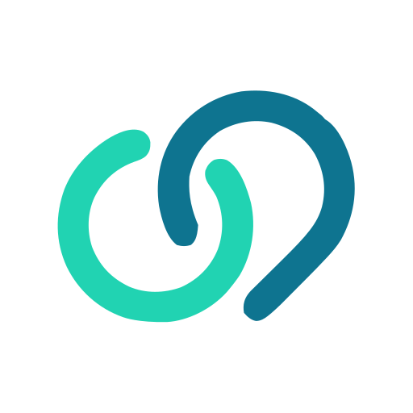
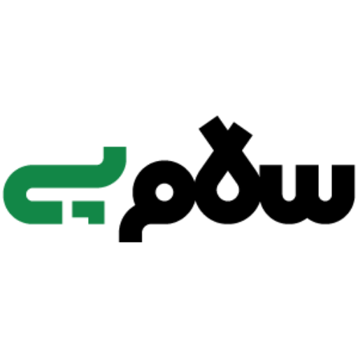
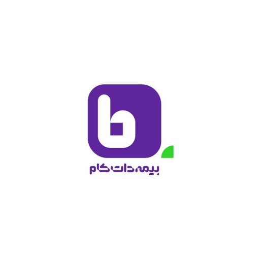

# گالری لوگوهای ندادم

این گالری از **۵۹ فایل لوگوی واقعی موجود در مخزن** ساخته شده است؛ تصویرها مستقیماً از فایل‌های SVG همین پروژه بارگذاری می‌شوند و لوگوی جایگزین یا نمونه اینترنتی نیستند.

تعداد: **59 برند**

| لوگو | لوگو | لوگو |
|:---:|:---:|:---:|
|<td align="center" width="33%"> <strong>آسان پرداخت</strong> asan-pardakht</td>|<td align="center" width="33%"> <strong>آینده</strong> ayandeh</td>|<td align="center" width="33%"> <strong>بانک مرکزی</strong> bank-markazi</td>|
|<td align="center" width="33%"> <strong>بانکینو</strong> bankino</td>|<td align="center" width="33%"> <strong>بلو بانک</strong> blu-bank</td>|<td align="center" width="33%"> <strong>کاسپین</strong> caspian</td>|
|<td align="center" width="33%"> <strong>دی</strong> dey</td>|<td align="center" width="33%"> <strong>دیجی‌پی</strong> digipay</td>|<td align="center" width="33%"> <strong>اقتصاد نوین</strong> eghtesad-novin</td>|
|<td align="center" width="33%"> <strong>گردشگری</strong> gardeshgari</td>|<td align="center" width="33%"> <strong>حسابیت</strong> hesabit</td>|<td align="center" width="33%"> <strong>آیدی‌پی</strong> idpay</td>|
|<td align="center" width="33%"> <strong>ایران زمین</strong> iran-zamin</td>|<td align="center" width="33%"> <strong>کارآفرین</strong> karafarin</td>|<td align="center" width="33%"> <strong>کشاورزی</strong> keshavarzi</td>|
|<td align="center" width="33%"> <strong>خاورمیانه</strong> khavar-mianeh</td>|<td align="center" width="33%"> <strong>مسکن</strong> maskan</td>|<td align="center" width="33%"> <strong>مهر ایران</strong> mehr-iran</td>|
|<td align="center" width="33%"> <strong>ملل</strong> melall</td>|<td align="center" width="33%"> <strong>ملت</strong> mellat</td>|<td align="center" width="33%"> <strong>ملی</strong> melli</td>|
|<td align="center" width="33%"> <strong>نور</strong> noor</td>|<td align="center" width="33%"> <strong>پارسیان</strong> parsian</td>|<td align="center" width="33%"> <strong>پاسارگاد</strong> pasargad</td>|
|<td align="center" width="33%"> <strong>پست بانک</strong> post</td>|<td align="center" width="33%"> <strong>رفاه</strong> refah</td>|<td align="center" width="33%"> <strong>رسالت</strong> resalat</td>|
|<td align="center" width="33%"> <strong>صادرات</strong> saderat</td>|<td align="center" width="33%"> <strong>سامان</strong> saman</td>|<td align="center" width="33%"> <strong>صنعت و معدن</strong> sanat-madan</td>|
|<td align="center" width="33%"> <strong>سرمایه</strong> sarmayeh</td>|<td align="center" width="33%"> <strong>سپه</strong> sepah</td>|<td align="center" width="33%"> <strong>انصار (ادغام‌شده در سپه)</strong> sepah-merged-ansar</td>|
|<td align="center" width="33%"> <strong>قوامین (ادغام‌شده در سپه)</strong> sepah-merged-ghavamin</td>|<td align="center" width="33%"> <strong>حکمت ایرانیان (ادغام‌شده در سپه)</strong> sepah-merged-hekmat</td>|<td align="center" width="33%"> <strong>کوثر (ادغام‌شده در سپه)</strong> sepah-merged-kosar</td>|
|<td align="center" width="33%"> <strong>مهر اقتصاد (ادغام‌شده در سپه)</strong> sepah-merged-mehr-eghtesad</td>|<td align="center" width="33%"> <strong>شهر</strong> shahr</td>|<td align="center" width="33%"> <strong>سینا</strong> sina</td>|
|<td align="center" width="33%"> <strong>اسنپ‌پی</strong> snapp-pay</td>|<td align="center" width="33%"> <strong>استاندارد چارترد</strong> standard-chartered</td>|<td align="center" width="33%"> <strong>تعاون اسلامی</strong> taavon-eslami</td>|
|<td align="center" width="33%"> <strong>تجارت</strong> tejarat</td>|<td align="center" width="33%"> <strong>توسعه</strong> tosee</td>|<td align="center" width="33%"> <strong>توسعه صادرات</strong> tosee-saderat</td>|
|<td align="center" width="33%"> <strong>توسعه تعاون</strong> tosee-taavon</td>|<td align="center" width="33%"> <strong>تارا</strong> tara</td>|<td align="center" width="33%"> <strong>ازکی‌وام</strong> azkivam</td>|
|<td align="center" width="33%"> <strong>تکنوپی</strong> technopay</td>|<td align="center" width="33%"> <strong>ویپاد</strong> vepod</td>|<td align="center" width="33%"> <strong>دیما</strong> dima</td>|
|<td align="center" width="33%"> <strong>سلام‌پی</strong> salam-pay</td>|<td align="center" width="33%"> <strong>بیمه‌بازار</strong> bimebazar</td>|<td align="center" width="33%"> <strong>ازکی</strong> azki-insurance</td>|
|<td align="center" width="33%"> <strong>بیمه دات‌کام</strong> bimehdotcom</td>|<td align="center" width="33%"> <strong>ترب‌پی</strong> torob-pay</td>|<td align="center" width="33%"> <strong>طلاسی</strong> talasea</td>|
|<td align="center" width="33%"> <strong>آسیاتک</strong> asiatech</td>|<td align="center" width="33%"> <strong>مخابرات</strong> telecommunication-company-of-iran</td>|<td></td>|

---

منبع فهرست: [brand-catalog.json](./catalog/brand-catalog.json) · پوشه فایل‌ها: [logos](./logos)
