# گالری لوگوهای ندادم

**تعداد: 58 برند**

این صفحه تصاویر را مستقیماً از فایل‌های لوگوی موجود در مخزن نمایش می‌دهد.

<table>
<tr><td align="center" valign="middle" width="33%"> <strong>آسان پرداخت</strong></td><td align="center" valign="middle" width="33%"> <strong>آینده</strong></td><td align="center" valign="middle" width="33%"> <strong>بانک مرکزی</strong></td></tr>
<tr><td align="center" valign="middle" width="33%"> <strong>بانکینو</strong></td><td align="center" valign="middle" width="33%"> <strong>بلو بانک</strong></td><td align="center" valign="middle" width="33%"> <strong>کاسپین</strong></td></tr>
<tr><td align="center" valign="middle" width="33%">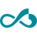 <strong>دی</strong></td><td align="center" valign="middle" width="33%">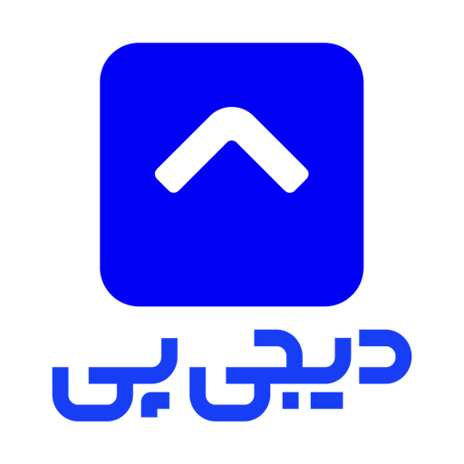 <strong>دیجی‌پی</strong></td><td align="center" valign="middle" width="33%"> <strong>اقتصاد نوین</strong></td></tr>
<tr><td align="center" valign="middle" width="33%"> <strong>گردشگری</strong></td><td align="center" valign="middle" width="33%"> <strong>حسابیت</strong></td><td align="center" valign="middle" width="33%"> <strong>آیدی‌پی</strong></td></tr>
<tr><td align="center" valign="middle" width="33%"> <strong>ایران زمین</strong></td><td align="center" valign="middle" width="33%"> <strong>کارآفرین</strong></td><td align="center" valign="middle" width="33%">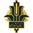 <strong>کشاورزی</strong></td></tr>
<tr><td align="center" valign="middle" width="33%"> <strong>خاورمیانه</strong></td><td align="center" valign="middle" width="33%"> <strong>مسکن</strong></td><td align="center" valign="middle" width="33%"> <strong>مهر ایران</strong></td></tr>
<tr><td align="center" valign="middle" width="33%"> <strong>ملل</strong></td><td align="center" valign="middle" width="33%">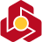 <strong>ملت</strong></td><td align="center" valign="middle" width="33%"> <strong>ملی</strong></td></tr>
<tr><td align="center" valign="middle" width="33%"> <strong>نور</strong></td><td align="center" valign="middle" width="33%"> <strong>پارسیان</strong></td><td align="center" valign="middle" width="33%"> <strong>پاسارگاد</strong></td></tr>
<tr><td align="center" valign="middle" width="33%"> <strong>پست بانک</strong></td><td align="center" valign="middle" width="33%"> <strong>رفاه</strong></td><td align="center" valign="middle" width="33%"> <strong>رسالت</strong></td></tr>
<tr><td align="center" valign="middle" width="33%"> <strong>صادرات</strong></td><td align="center" valign="middle" width="33%"> <strong>سامان</strong></td><td align="center" valign="middle" width="33%"> <strong>صنعت و معدن</strong></td></tr>
<tr><td align="center" valign="middle" width="33%"> <strong>سرمایه</strong></td><td align="center" valign="middle" width="33%"> <strong>سپه</strong></td><td align="center" valign="middle" width="33%"> <strong>انصار (ادغام‌شده در سپه)</strong></td></tr>
<tr><td align="center" valign="middle" width="33%"> <strong>قوامین (ادغام‌شده در سپه)</strong></td><td align="center" valign="middle" width="33%"> <strong>حکمت ایرانیان (ادغام‌شده در سپه)</strong></td><td align="center" valign="middle" width="33%"> <strong>کوثر (ادغام‌شده در سپه)</strong></td></tr>
<tr><td align="center" valign="middle" width="33%"> <strong>مهر اقتصاد (ادغام‌شده در سپه)</strong></td><td align="center" valign="middle" width="33%"> <strong>شهر</strong></td><td align="center" valign="middle" width="33%"> <strong>سینا</strong></td></tr>
<tr><td align="center" valign="middle" width="33%"> <strong>اسنپ‌پی</strong></td><td align="center" valign="middle" width="33%"> <strong>استاندارد چارترد</strong></td><td align="center" valign="middle" width="33%"> <strong>تعاون اسلامی</strong></td></tr>
<tr><td align="center" valign="middle" width="33%"> <strong>تجارت</strong></td><td align="center" valign="middle" width="33%"> <strong>توسعه</strong></td><td align="center" valign="middle" width="33%"> <strong>توسعه صادرات</strong></td></tr>
<tr><td align="center" valign="middle" width="33%"> <strong>توسعه تعاون</strong></td><td align="center" valign="middle" width="33%"> <strong>تارا</strong></td><td align="center" valign="middle" width="33%">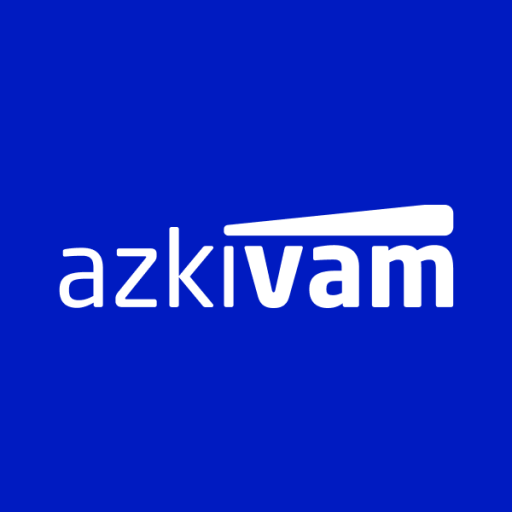 <strong>ازکی‌وام</strong></td></tr>
<tr><td align="center" valign="middle" width="33%"> <strong>ویپاد</strong></td><td align="center" valign="middle" width="33%">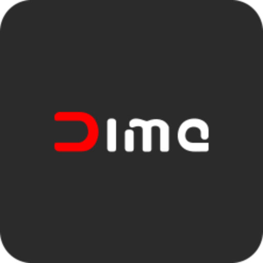 <strong>دیما</strong></td><td align="center" valign="middle" width="33%"> <strong>سلام‌پی</strong></td></tr>
<tr><td align="center" valign="middle" width="33%">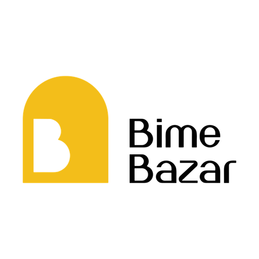 <strong>بیمه‌بازار</strong></td><td align="center" valign="middle" width="33%">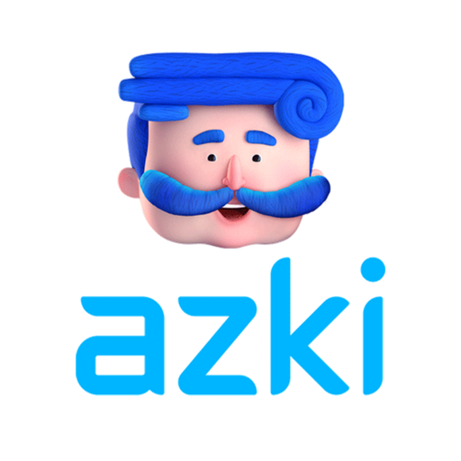 <strong>ازکی</strong></td><td align="center" valign="middle" width="33%"> <strong>بیمه دات‌کام</strong></td></tr>
<tr><td align="center" valign="middle" width="33%">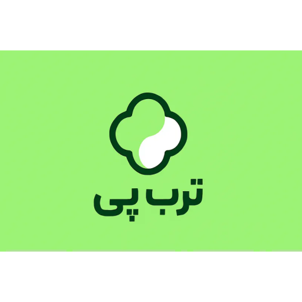 <strong>ترب‌پی</strong></td><td align="center" valign="middle" width="33%">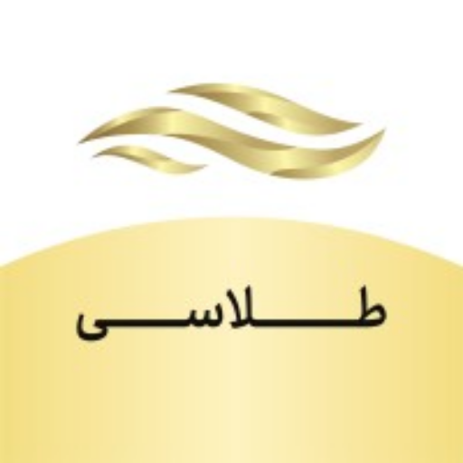 <strong>طلاسی</strong></td><td align="center" valign="middle" width="33%">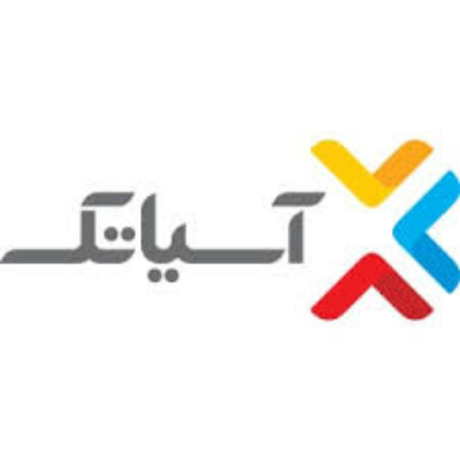 <strong>آسیاتک</strong></td></tr>
<tr><td align="center" valign="middle" width="33%">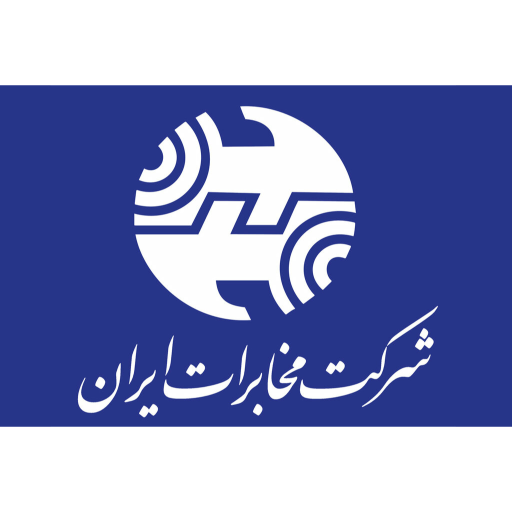 <strong>مخابرات</strong></td><td></td><td></td></tr>
</table>

منبع فهرست: [brand-catalog.json](./catalog/brand-catalog.json) · [پوشه فایل‌های لوگو](./logos)
